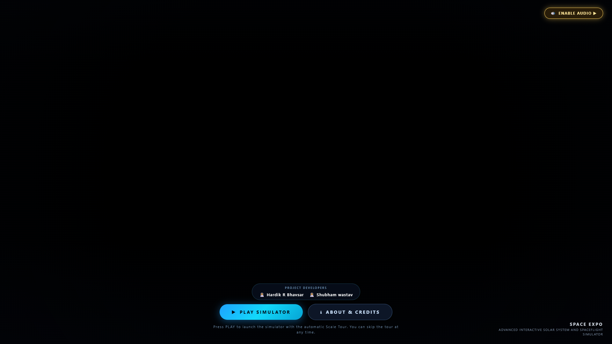
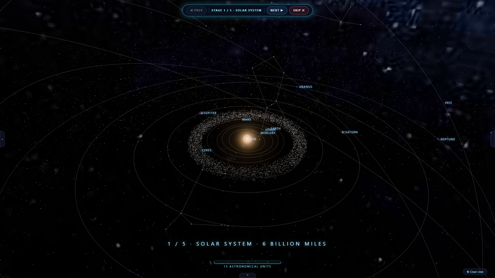
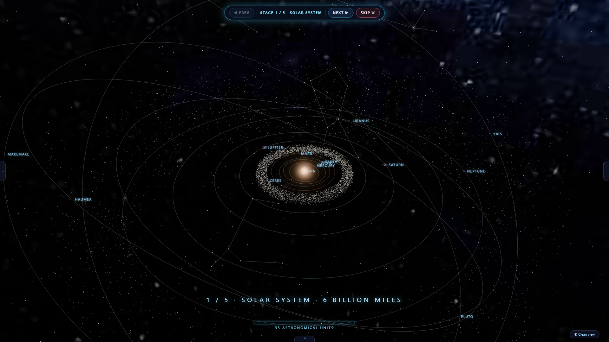
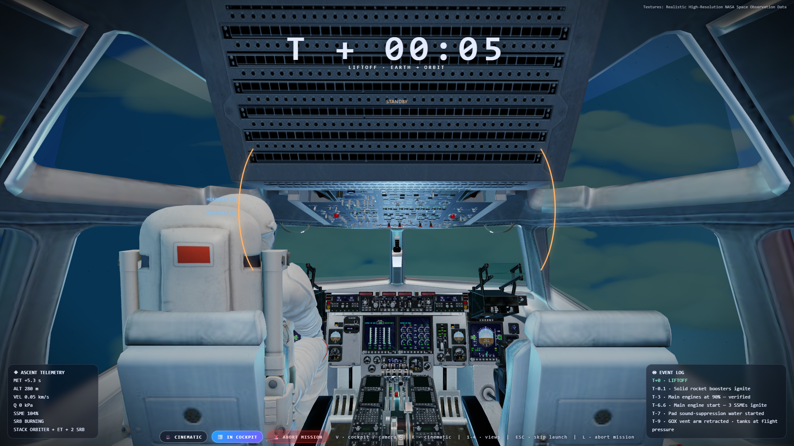
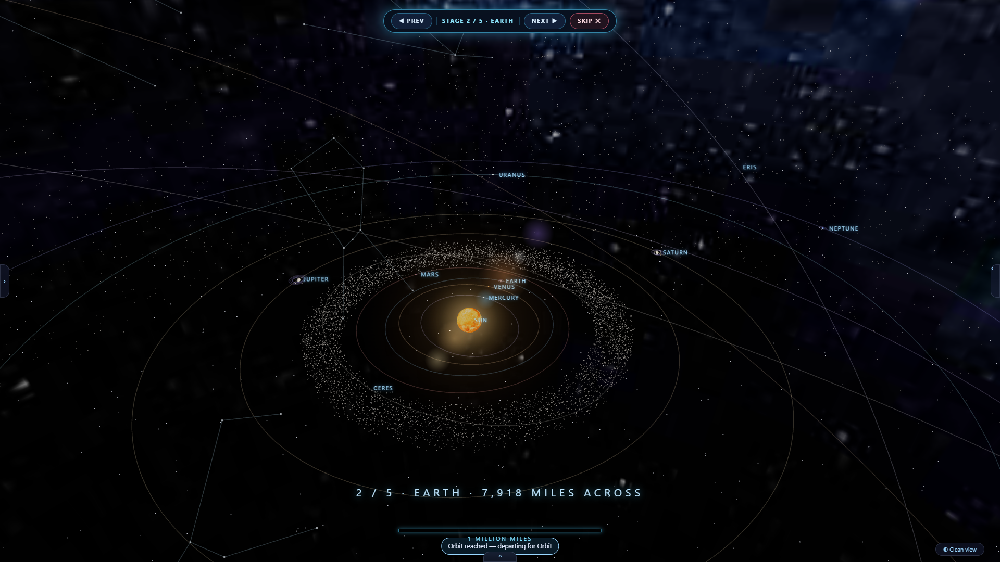
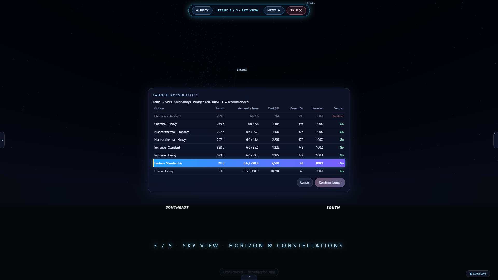

# SPACE EXPO — Advanced Interactive Solar System & Spaceflight Simulator

<div align="center">

[](https://spacexpo.pages.dev)
[](https://threejs.org/)
[](https://ssd.jpl.nasa.gov/horizons/)
[](https://creativecommons.org/licenses/by/4.0/)
[](https://github.com/bhawsarhardik195-blip/SPACE-EXPO.git)

### 🚀 [**Launch Live Simulator on Cloudflare Pages**](https://spacexpo.pages.dev)

An interactive, scientifically calibrated solar system exploration and spaceflight simulation engine running entirely in the browser.

</div>

---

## 🌌 Project Overview

**SPACE EXPO** pairs physically grounded Keplerian astrodynamics with high-fidelity 3D spacecraft piloting, realistic atmospheric ascent, an interactive 360° flight deck cockpit, and spatial acoustic audio. Built with Three.js and WebGL, the simulation enables users to explore the solar system at true relative scales, inspect planetary bodies, and command interplanetary orbital transfers calculated with NASA JPL ephemeris parameters.

---

## 📸 Visual Gallery & Screenshots

*All screenshots below are captured directly from live simulation sessions:*

### 1. Main Landing & Mission Command

*Cinematic landing interface featuring mission briefings, telemetry status, launch pad countdown, and ambient spatial audio.*

---

### 2. Keplerian Solar System Exploration

*Interactive 3D view of the solar system featuring 28+ celestial bodies with accurate orbital inclination, semi-major axis, and real-time orbital propagation.*

---

### 3. Planetary Telemetry & Surface Inspection

*Detailed planetary exploration HUD presenting physical characteristics, gravity, orbital velocities, surface textures, and atmospheric composition (shown: Mars).*

---

### 4. Atlantis Spacecraft & 360° Cockpit Avionics

*High-fidelity Atlantis spacecraft with functional 360° glass cockpit flight deck, Primary Flight Display (PFD), attitude indicators, and cabin acoustic isolation.*

---

### 5. High-Fidelity Earth Orbital Scene (T+20 to T+24 Transition)

*Earth orbital insertion showcasing the clean, high-detail Earth surface rendered following the seamless transition interval between T+20 and T+24 seconds.*

---

### 6. Interplanetary Flight Simulation & Mission Controls

*Interplanetary mission planner with Lambert transfer trajectories, velocity delta readouts, orbital maneuvers, and flight control panels.*

---

## 🛠️ Technology Stack

| Layer | Technologies | Purpose |
| :--- | :--- | :--- |
| **Graphics Engine** | **WebGL**, **Three.js (r128+)** | Real-time 3D rendering, PBR materials, custom atmospheric shaders, normal mapping, dynamic shadow maps |
| **Animation Core** | **GSAP (GreenSock)** | Smooth cinematic camera transitions, HUD motion, launchpad camera sequencing |
| **Astrodynamics** | **Custom Physics Engine (ES6+)** | Keplerian orbital elements, 3D patched-conic Hohmann transfers, Runge-Kutta 4th-order (RK4) numerical integration |
| **Audio Architecture**| **Web Audio API** | Multi-channel audio bus routing, real-time gain ducking, low-pass cockpit acoustic filtration |
| **Frontend Platform** | **HTML5 Canvas**, **CSS3 Flex/Grid** | Responsive HUD displays, telemetry readouts, mission briefing modals, cross-platform canvas rendering |
| **Deployment Edge** | **Cloudflare Pages** | Global edge network delivery with custom redirect rules (`_redirects`) and fallback routing |

---

## ✨ Key Implemented Features

### 1. Keplerian Solar System & N-Body Precision
- **28+ Modeled Celestial Bodies**: Includes all 8 major planets, the Moon, Galilean moons (Io, Europa, Ganymede, Callisto), Titan, Triton, dwarf planets (Pluto, Ceres), and major asteroids.
- **Accurate Astronomical Parameters**: Semi-major axis, eccentricity, inclination, longitude of ascending node, argument of periapsis, and mean anomaly calibrated against **NASA JPL Horizons**.

### 2. Atmospheric Ascent & Volumetric Clouds
- Photorealistic launchpad environment with umbilical tower, vapor clouds, and flame trench effects.
- Dynamic rocket booster ascent through physical volumetric cloud layers during liftoff.
- **Precision Earth Transition**: Smoothly transitions the Earth surface texture between **T+20 and T+24 seconds** to reveal the crisp, pristine Earth surface from orbit.

### 3. Integrated Atlantis Spaceship & 360° Glass Cockpit
- High-fidelity Atlantis spacecraft exterior model complete with RCS thruster quads and orbital maneuvering systems.
- Fully interactive internal flight deck with 360° panoramic rotation (`C` key toggle).
- Integrated Primary Flight Display (PFD), altitude telemetry, orbital velocity readouts, and cabin ventilation hum.

### 4. Mission Planner & Lambert Trajectory Solver
- Interactive origin-to-destination targeting across the entire solar system.
- Delta-v calculations, transfer burn time estimates, and projected orbital trajectory paths rendered in real time.

### 5. Universal Simulation Flight Controls

| Key / Input | Action | Description |
| :--- | :--- | :--- |
| `ESC` | **Skip Initial Launch** | Instantly completes liftoff and transitions directly to the Earth orbital scene |
| `L` | **Abort Mission** | Cleanly terminates the active mission and returns to orbital standby |
| `C` | **Toggle Cockpit** | Switches between third-person spacecraft tracking and first-person 360° cockpit |
| `Left Click + Drag` | **Orbit Camera** | Rotates camera around the targeted spacecraft or celestial body |
| `Right Click + Drag`| **Pan Camera** | Moves camera focus across the spatial viewport |
| `Mouse Wheel` | **Zoom** | Smooth continuous magnification from surface level to cosmic scales |
| `Time Scale Buttons`| **Time Warp** | Accelerates simulation time from `0.5x` up to `100x` |

---

## 🏛️ System Architecture

```
                               ┌────────────────────────────────┐
                               │   User Input & Keybindings     │
                               │  (ESC Skip, L Abort, C Cockpit)│
                               └───────────────┬────────────────┘
                                               │
                                               ▼
┌─────────────────────────────────────────────────────────────────────────────────────────────┐
│                                   SPACE EXPO Engine Core                                    │
├──────────────────────────────┬──────────────────────────────┬───────────────────────────────┤
│    Astrodynamics Engine      │       Rendering Engine       │         Audio Manager         │
│  • Keplerian Orbit Solver    │  • Three.js WebGL Scene      │  • Multi-Bus Web Audio Graph  │
│  • Lambert Solver (RK4)      │  • Atmosphere Shader Pipeline│  • Dynamic Ducking Engine     │
│  • NASA JPL Ephemeris Data   │  • T+20 to T+24 Transition   │  • Cabin Acoustic Low-Pass    │
└──────────────────────────────┴──────────────────────────────┴───────────────────────────────┘
                                               │
                                               ▼
                               ┌────────────────────────────────┐
                               │      Cloudflare Pages Edge     │
                               │    https://spacexpo.pages.dev  │
                               └────────────────────────────────┘
```

---

## 📂 Directory Structure

```
uploading/
├── index.html                           # Root entry point & universal redirector
├── Space Expo Enhanced Upgrade.html     # Complete production simulation engine & WebGL bundle
├── _redirects                           # Cloudflare Pages SPA rewrite and redirect rules
├── .gitignore                           # Git exclusion rules
├── README.md                            # Comprehensive project documentation
├── DEVELOPMENT.md                       # Local development and web server guide
├── front page.jpeg                      # Project splash imagery
├── front page.mp4                       # Background video backdrop
├── audio/                               # Compressed spatial audio assets
│   ├── cockpit 1.mpeg                   # Flight deck avionics hum
│   ├── cockpit 2.mpeg                   # Cabin ventilation atmosphere
│   ├── intro.mpeg                       # Ambient soundtrack ("Interstellar Shores")
│   ├── scale tour.mpeg                  # Cosmic exploration soundtrack
│   └── thrust.mpeg                      # Rocket ascent propulsion SFX
├── screenshots/                         # Captured simulator screenshots
│   ├── 01_landing_page.png              # Main landing & launchpad view
│   ├── 02_solar_system.png              # Solar system & orbital paths
│   ├── 03_planet_exploration.png        # Planet inspection & telemetry
│   ├── 04_spaceship_cockpit.png         # Atlantis spaceship & 360° cockpit
│   ├── 05_earth_orbital_scene.png       # Earth orbital view post-transition
│   └── 06_spaceflight_simulation.png    # Mission trajectory planner
└── eath view/                           # High-resolution planet & launchpad textures
    ├── cockpit views/                   # Cockpit reference textures & video
    ├── earth from space/                # Orbital Earth imagery
    ├── earth land texture/              # High-res Earth surface textures
    ├── launch pad/                      # Launch complex structures
    └── launch pad surrounding/          # Terrestrial terrain & atmospheric backdrop
```

---

## 🎵 Audio Credits & Attributions

SPACE EXPO features an adaptive multi-channel spatial audio architecture built on the Web Audio API with dynamic ducking, cross-fading, and cabin isolation filters. All audio tracks, soundscapes, and acoustic assets used within the simulator are credited below with their verified creator and source attributions:

| Audio Role / Simulator Usage | Project File Path | Audio Track Title | Creator / Channel | Source Link | Verification Status |
| :--- | :--- | :--- | :--- | :--- | :--- |
| **🌌 Intro Sound**<br>Homepage ambient backdrop, cinematic intro sequence, and launch countdown audio | [`audio/intro.mpeg`](audio/intro.mpeg) | *Interstellar Shores \| Dream Space Ambient Music Journey Through Cosmic Landscapes \| 4K* | **VIATMOS** | [Watch on YouTube](https://youtu.be/bbTgNS7_BVc) | **Verified** |
| **🔭 Explorer / Tour Sound**<br>Solar System scale tour, cosmic navigation, and deep-space celestial exploration | [`audio/scale tour.mpeg`](audio/scale%20tour.mpeg) | *Not verified* | *Not verified* | [Watch on YouTube Shorts](https://youtube.com/shorts/o4_gUguEhkk) | **Source URL Verified**<br>*(Creator & Title Not verified)* |
| **🎛️ Cockpit Sound**<br>Interactive 360° flight deck ambience, dual-channel avionics hum & cabin ventilation | [`audio/cockpit 1.mpeg`](audio/cockpit%201.mpeg)<br>[`audio/cockpit 2.mpeg`](audio/cockpit%202.mpeg) | *Cockpit Flight Deck Ambience (Layered A & B)* | *Not verified (Project Asset)* | Local Project Asset | **Project Local Asset**<br>*(Creator Not verified)* |
| **🚀 Rocket Thrust SFX**<br>Main engine atmospheric boost phase and interplanetary orbital transfer burn | [`audio/thrust.mpeg`](audio/thrust.mpeg) | *Spacecraft Main Engine Ascent & Burn SFX* | *Not verified (Project Asset)* | Local Project Asset | **Project Local Asset**<br>*(Creator Not verified)* |
| **🎙️ Celestial Voice Narration**<br>Automated celestial body guide and mission briefing voiceover sample | *Local asset* | *Mission Voice Briefing Sample* | *Not verified (Project Asset)* | Local Project Asset | **Project Local Asset**<br>*(Creator Not verified)* |

> [!NOTE]
> Per attribution and verification guidelines:
> - If an audio asset's creator name or specific composition title could not be confirmed independently from author records, it is explicitly cataloged as **Not verified** rather than assuming or inventing placeholder data.
> - Source links point to the verified original upload locations.

---

## 👥 Project Team & Credits

- **Hardik R Bhavsar** — Project Lead, Astrodynamics Architecture, 3D Simulation Development
- **Sugam Vasta** — Simulation Design, Systems Engineering, Visual Integration

### Scientific & Data Attributions:
- **Orbital Mechanics & Planetary Ephemeris**: Public domain astrodynamic constants courtesy of **NASA Jet Propulsion Laboratory (JPL)** Horizons system and **NASA Goddard Space Flight Center (GMAT)**.
- **Planetary Surface Textures**: **NASA**, **ESA**, **USGS Astrogeology Science Center**, and **Solar System Scope** (Creative Commons Attribution 4.0 International).

---

## 💻 Local Development

For complete local server setup instructions, Nginx/Docker configurations, and audio autoplay troubleshooting, refer to [**DEVELOPMENT.md**](DEVELOPMENT.md).

### Quick Start (Python 3):
```bash
python -m http.server 8080
```
Open your browser at `http://localhost:8080/`.

---

<div align="center">
  <sub>SPACE EXPO © 2026. Developed by Hardik R Bhavsar & Sugam Vasta.</sub>
</div>
